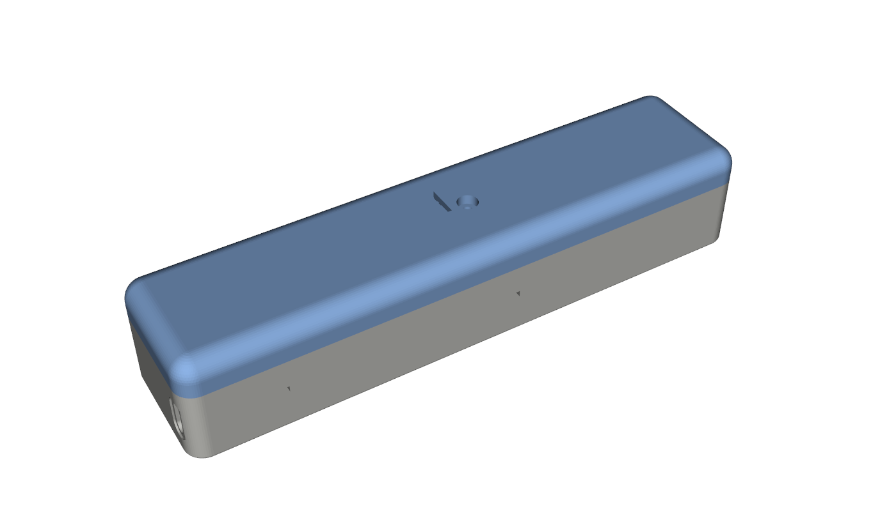
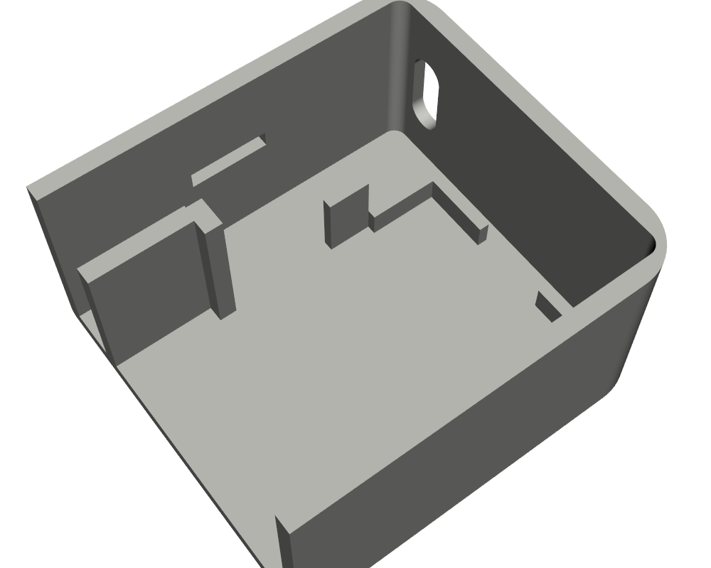
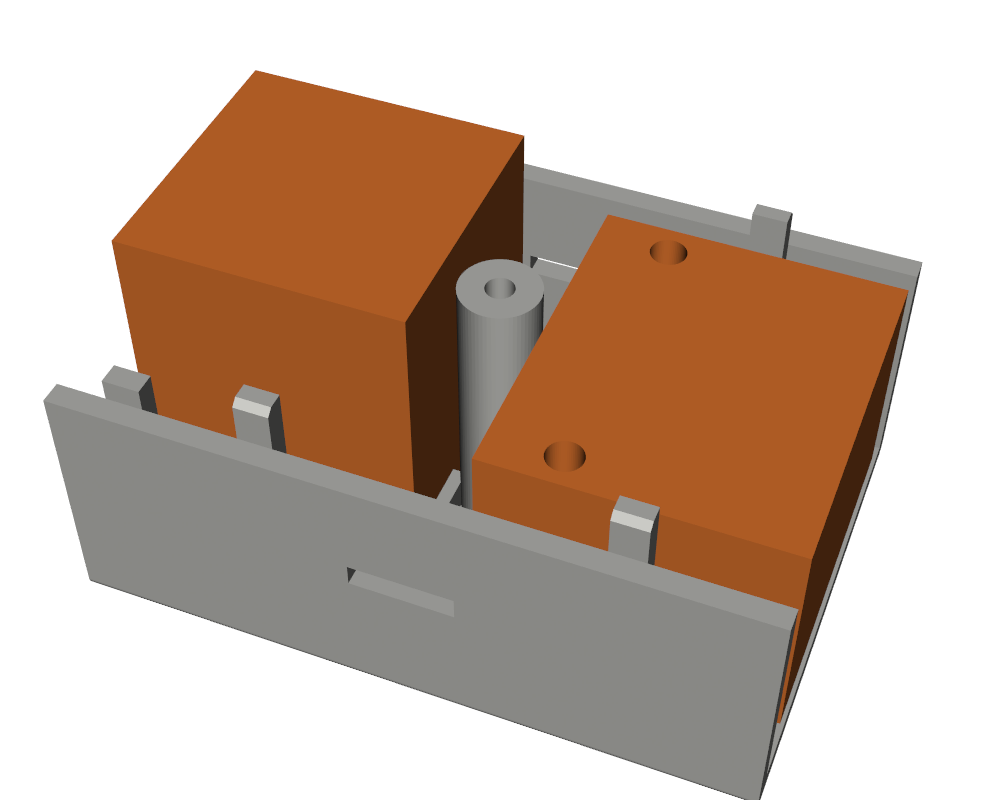
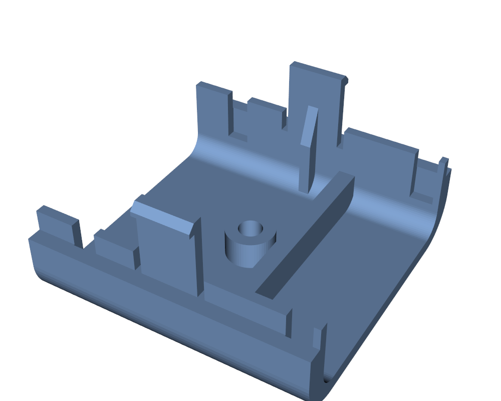
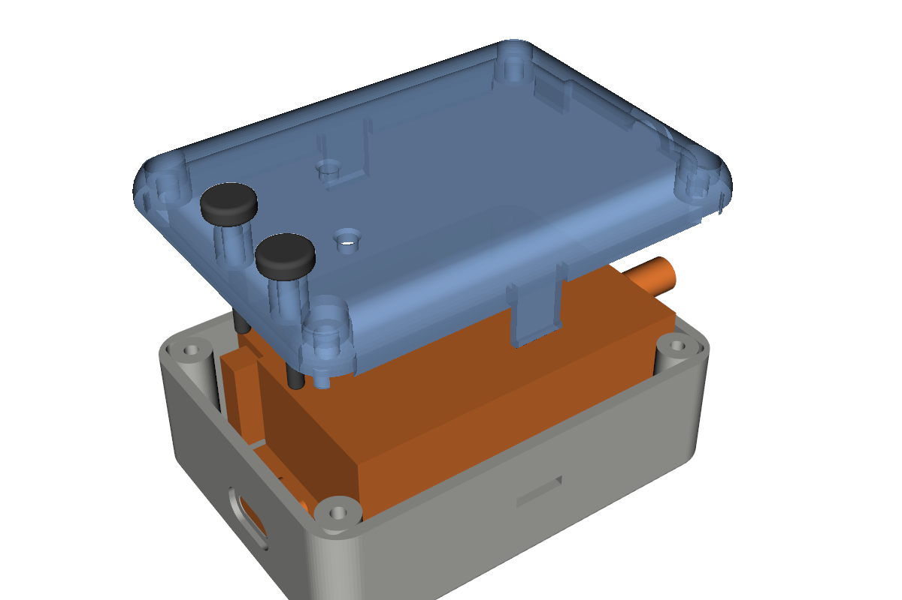
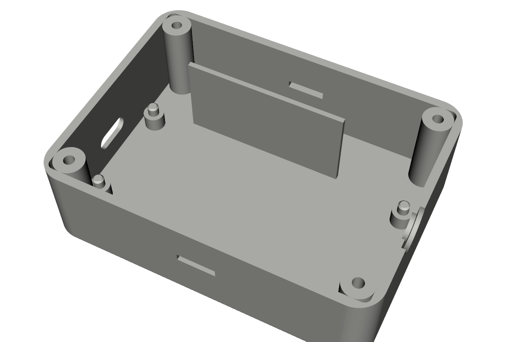

# Sensor enclosure (resin print, snap-fit lid)






Box for the battery sensor: 21700 holder (85 x 25 x 25) and the DX-PJ26 (72 x 30 PCB) + LR30-A +
perfboard stack (20 high) in line. The TP4056 USB-C charger and then the reed board stand on
edge beside the battery holder, both against the low-Y (PB side) wall.
Outside 176.5 x 41.6 x 33.5 mm.

| File | Use |
|---|---|
| `door_sensor_box_base.step`, `door_sensor_box_lid.step` | Open in Fusion 360 (solid bodies) |
| `door_sensor_box_assembly.step` | Base + lid + orange reference blocks for the components |
| `door_sensor_box_base.stl`, `door_sensor_box_lid.stl` | Print |
| `door_sensor_box.py` | Parametric source (CadQuery); every size is at the top |

## Design

- **Lid**: R6 rounded top edges and corners. It snaps on with four cantilever tabs, two per long
  side (1.4 mm thick, 11 mm long, 0.8 mm hook since print 2), into windows in the long walls:
  on the low-Y side over the charger and in the battery/board gap, on the high-Y side in that gap
  and over the board, where there is room for a root gusset (`TABS`). Each tab has a 1.6 mm rib
  on its inner side from the lid's inner top down to half its length (`GUSSET_TO`), because the
  print-2 tabs broke at the root. That leaves only the lower half to flex: about 6.6% strain at
  the gusset tip for the 0.95 mm hook deflection (1.6% without the gusset), so use a tough resin;
  `GUSSET_TO` 0.25 or `HOOK_DEPTH` 0.5 bring it down. On the first print the hooks sat too high to lock,
  so the windows in both boxes are 0.5 mm higher than the nominal hook position
  (`WINDOW_Z_OFF`): 0.6 mm above the catch face, and at the nominal lid height the hook's
  lead-in rests 0.2 mm on the window's lower edge.
- **Centre screw**: one M3 x 12 self-tapping screw in the middle of the lid, between the
  battery holder and the board. A 7 mm boss in the base (2.5 mm pilot, 9 mm of thread) meets a
  4 mm pillar under the lid top (counterbored head, 3 mm deep), 0.1 mm short so the screw pulls
  the lid onto the walls. The gap there is 8.4 mm (`MID_GAP`), leaving room for wires on both
  sides of the boss.
- **Battery isolation slot**: a 10 x 2 mm slot in the lid across the cell, right over where its
  + end meets the holder's contact (next to the centre screw), for a plastic tab that keeps the
  battery disconnected (instead of paper). Its centre is 3.5 mm in from the holder's end
  (`HOLDER_END_T`; 2 mm at first, moved 1.5 mm toward the battery by the user).
- **Walls**: vertical stiffening ribs (3 mm wide, 2 mm thick; 2 x 1.2 until print 2) on the inside of both long walls, away from the
  tabs; the low-Y ones skip the reed slot (`WALL_RIB_X`). They rise 4 mm above the base edge
  (`WALL_RIB_UP`, chamfered on the wall side) into slots in the lid's lip and inner thickening,
  where the lid's outer wall stops the long walls bowing outward (they did on print 2). To open, push the hooks
  in through the windows with a pin. A 3 mm lip aligns it. Two ribs hold the battery holder down
  (0.5 mm gap; add foam tape for a tight fit). The cell in its holder stands 26 mm above the
  floor (5 mm above the base edge on the first print, which kept the lid from closing); the
  print-2 lid still pressed on it, so `BATT_H` is 27.5 and the lid is 10.5 mm tall.
- **SMA**: the base/lid split is at the SMA centre height, so the board drops in with the SMA in a
  half-round notch and the lid closes the top half. Its centre is 12.5 mm from the PB header
  edge (confirmed), which faces the low-Y wall with the USB end toward the battery; the carrier
  is flush with the PCB end. An 11 mm spot face thins the wall to 1 mm around it, leaving
  ~7.5 mm of thread outside for the antenna.
- **USB-C**: the charger stands on its long edge beside the battery holder, components and
  USB-C toward the wall, with its PCB edge against the end wall. The receptacle (vertical) goes
  into a rounded opening whose centre is 1.2 mm above the PCB's mid-height (the receptacle is
  off-centre; measured on the first print), with 0.6 mm clearance top and bottom. A 0.5 mm
  outside counterbore lets the plug overmold reach it. Nothing touches the
  component side: a rib holds the flat back, and a plate behind the rear edge takes the plug
  insertion force. The board is 28.26 mm long including the two ears at its rear corners
  (measured); the plate is 16.3 mm tall so both ears rest on it, and 2 mm thick toward the box's
  middle (`CHG_STOP_T`; the 1.2 mm one broke on print 2). Nothing reaches onto the faces
  at the rear edge, where the through-hole wire pads (B+/B-/OUT+/OUT-) are. The inner corners
  are 1.5 mm radius so the charger fits right into the corner.
- **First print (2026-11-02)**: the USB hole had to be opened 1.2 mm upward (now in
  `USB_Z_OFF`). The charger had been designed with its components toward the battery and a low
  rib on the wall side, which would touch the components once the board was mounted the other
  way. There was also no rear stop where the board actually sat. All fixed as above, not
  reprinted yet. The PCB length was 27 mm in the model; the real board is 28.26 with its ears.
- **Board**: no standoffs. Its four mounting holes (65.5 x 24.5 mm centres) drop onto 2.7 mm
  pins on 4 mm printed posts, which clear the header solder tails. A lid rib on the perfboard's
  blank rear strip keeps it on the pins, and the lid's SMA notch holds the other end.
- **Reed board**: slot against the low-Y wall (the PB header side, like the charger), right
  after the charger's rear stop and beside the battery holder, so the magnet goes on that face
  near the charger end. Its wires from PB13/GND stay on that side. The wall behind it is as
  tall as the charger's stop plate (16.3 mm) and 2 mm thick (`REED_WALL_H/T`; 6 mm until print 2).

## Measure before printing

These are estimates from photos; set them in `door_sensor_box.py` and rerun:

| Parameter | Now | What |
|---|---|---|
| `POST_H` | 4.0 | Must exceed the longest solder tail under the PCB |
| `PIN_D` | 2.7 | Mounting hole diameter minus ~0.4 (assumes 3.1-3.2 mm M3 holes) |
| `PERF_OVERHANG` | 3.0 | Perfboard beyond the PCB at the battery end (the lid rib lands 0.5-3 mm in from its edge) |
| `SMA_LEN` | 9.0 | SMA length beyond the carrier edge |
| `USB_PROTRUDE` | 1.5 | USB-C front beyond the charger PCB edge |
| `REED_L/H/T` | 33/10/5 | Reed board size, standing on edge (length from a photo) |

# Receiver enclosure




Box for the receiver: the same DX-PJ26 + LR30-A + perfboard stack and a Shelly UNI
(38.5 x 20.7 mm without its harness connector) standing on edge beside it, as in the photos.
Outside 77 x 56.7 x 30 mm.

| File | Use |
|---|---|
| `receiver_box_base.step`, `receiver_box_lid.step`, `receiver_box_stick.step` | Open in Fusion 360 |
| `receiver_box_assembly.step` | Base + lid + orange reference blocks (board, Shelly, switches, sticks) |
| `receiver_box_base.stl`, `receiver_box_lid.stl`, `receiver_box_stick.stl` | Print (print two sticks or one) |
| `receiver_box.py` | Parametric source (CadQuery) |

- **Lid**: R6 rounded top like the sensor box. One snap tab in the middle of each long side (two
  clicks), and four corner pillars for **M3 x 12** screws into bosses in the base (2.5 mm
  pilot, self-tapping; counterbored heads). Use the screws, the tabs, or both.
- **KEY / RST**: two 3 mm holes in the lid over the switches, each with a 6 mm guide cylinder
  under it. The push stick (2.5 mm shaft, 8 mm head) stops on the lid when its tip is 0.6 mm
  below the switch top. The switches are 3.8 mm from the PCB's USB end, 7.0 mm (KEY) and
  22.6 mm (RST) from the PB header edge.
- **LEDs**: two 3 mm holes in the lid over the two perfboard LEDs: 21.7 mm from the PCB's USB
  end / 25.4 mm from the PB edge, and 14.2 / 8.3 mm (`LEDS`).
- **Positions** of the switches and LEDs come from a top photo: a homography on the four
  mounting holes, plus a height correction for the perfboard (from its 2.54 mm pitch and its
  header-pin columns). About +-0.4 mm across the board and +-0.8 mm along it.
  `receiver_hole_check.png` shows the four holes projected back onto that photo (red = LEDs,
  blue = switches, circles = 3 mm).
- **Board**: pins in its four mounting holes, as in the sensor box. The PB header edge (KEY side)
  faces the low-Y wall. The SMA is 12.5 mm from that edge (confirmed) and goes through the
  wall at the base/lid split. The USB-C goes through the opposite end wall, so the board can be
  powered or flashed without opening the box.
- **Shelly UNI**: stands on its long edge along the high-Y wall, capacitor/connector side toward
  the board, MCU/u.FL side toward the wall. Its parts reach the PCB edges on both faces, so
  nothing grips it: a 1.2 mm partition, as tall as the base and 1.2 mm from the board's
  envelope (`PART_GAP`), runs along its length between it and the board and keeps it in its
  lane. The partition is open at both ends for the wires between the two. Its harness
  connector faces the USB wall. The end walls of its lane are closed (user's choice); a
  harness slot (`CABLE_A`, was 6 x 14 mm in the USB wall, beside the corner boss) and an
  output-wire hole (`CABLE_B`, was 7 mm in the SMA wall) can be turned back on.

Measure before printing (in `receiver_box.py`): `SH_IN` / `SH_OUT` (Shelly parts on each side,
7 / 2 mm assumed), `SH_CONN_L/H/T` (harness connector), `BTN_H` (switch height), `USB_PROTRUDE`.

## Rebuild

```
python -m venv cqenv
cqenv\Scripts\python.exe -m pip install cadquery
cqenv\Scripts\python.exe -I door_sensor_box.py
cqenv\Scripts\python.exe -I receiver_box.py
```

Each rewrites its STEP/STL files and prints any overlap between the parts and the component
blocks (the receiver also checks that each stick touches only its switch).

## Printing (resin)

Use a tough or ABS-like resin for the tabs; standard resin may crack them. Tilt each part
~30-45 degrees, support from the outside, and keep supports off the tabs and the lid's
top. Rinse and cure fully before the first snap.
